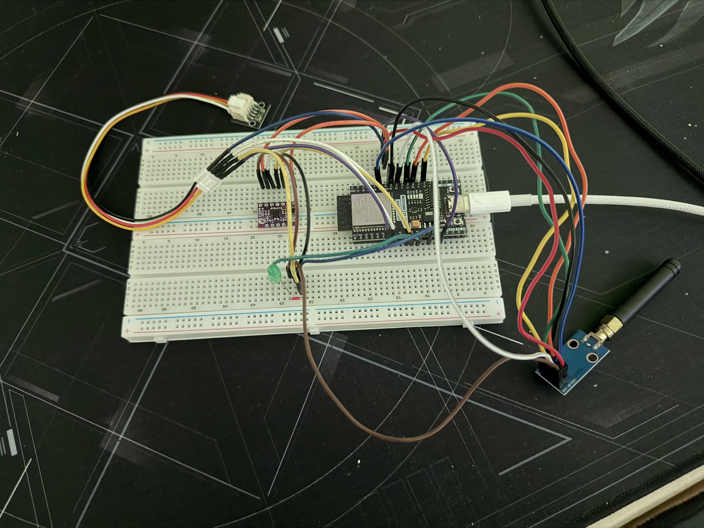
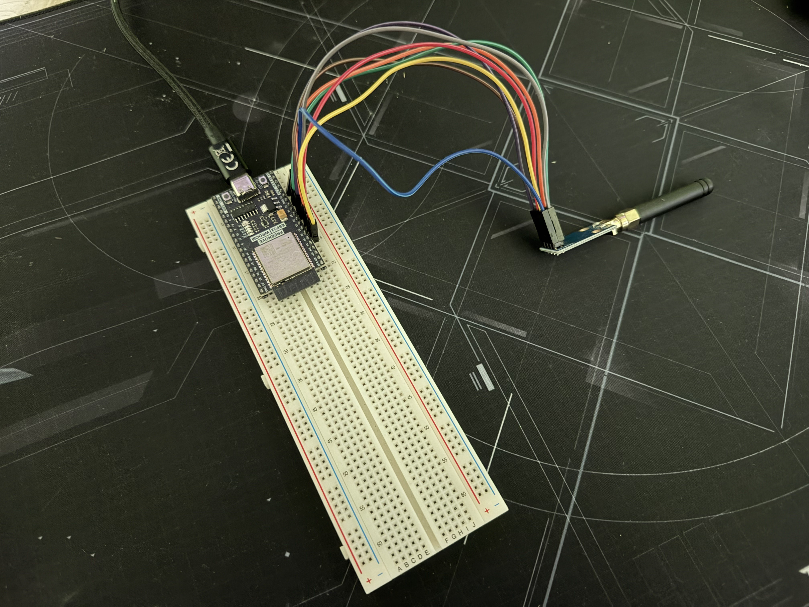

# ***Model Rocket Source Code***

> A model rocket's flight code and real-time telemetry ground receiver. The ground station receives live flight telemetry from the flight.

---

## 📋 Overview

### 🏛️ Project Structure

- `avionics-code`: rocket's flight code
- `ground-station`: real-time telemetry ground receiver code

### ⚙️ Components

- `Rocket MCU` and `Ground Station MCU`: ESP32-WROOM-32
- `IMU`: Bosch BMI160
- `Barometer`: Bosch BMP280
- `Radio Module (Rocket and Ground Station)`: Texas Instruments (TI) CC1101

### 🛠️ Tech Stack

- `Programming Language`: Rust
- `MCU Framework`: esp-hal
- `Async Framework`: Embassy

---

## 🎛️ Avionics Code

### 🔌 Pinout

#### 🧭 IMU

| Protocol | SDA | SCL
| --- | --- | ---
| `I2C` | GPIO 26 | GPIO 27

---

#### 🌡️ Barometer

| Protocol | SDA | SCL
| --- | --- | ---
| `I2C` | GPIO 33 | GPIO 32

---

#### 🛰️ Radio Module

| Protocol | SCLK | MOSI | MISO | CS | GDO0 | GDO2
| --- | --- | --- | --- | --- | --- | ---
| `SPI` | GPIO 0 | GPIO 16 | GPIO 17 | GPIO 21 | GPIO 18 | GPIO 19

---

## 📡 Ground Station

### 🔌 Pinout

#### 🛰️ Radio Module

| Protocol | SCLK | MOSI | MISO | CS | GDO0 | GDO2
| --- | --- | --- | --- | --- | --- | ---
| `SPI` | GPIO 32 | GPIO 25 | GPIO 27 | GPIO 14 | GPIO 35 | GPIO 33

---

## 📄 License

This repository is dual-licensed:

- [LICENSE-MIT](LICENSE-MIT) or https://opensource.org/license/mit
- [LICENSE APACHE-2.0](LICENSE-APACHE) or https://www.apache.org/licenses/LICENSE-2.0
